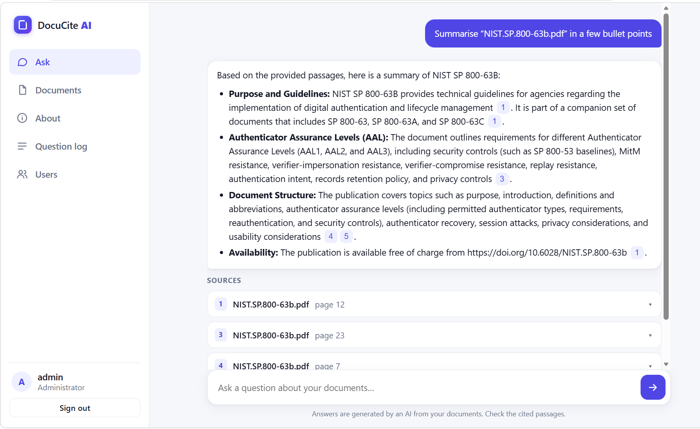
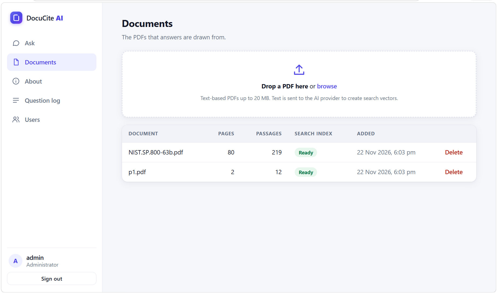
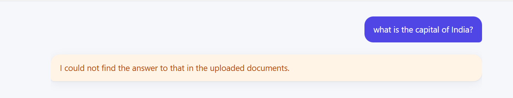
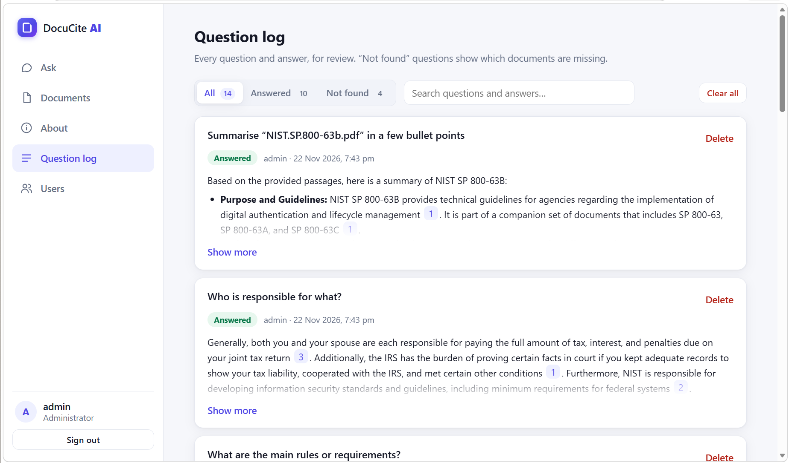
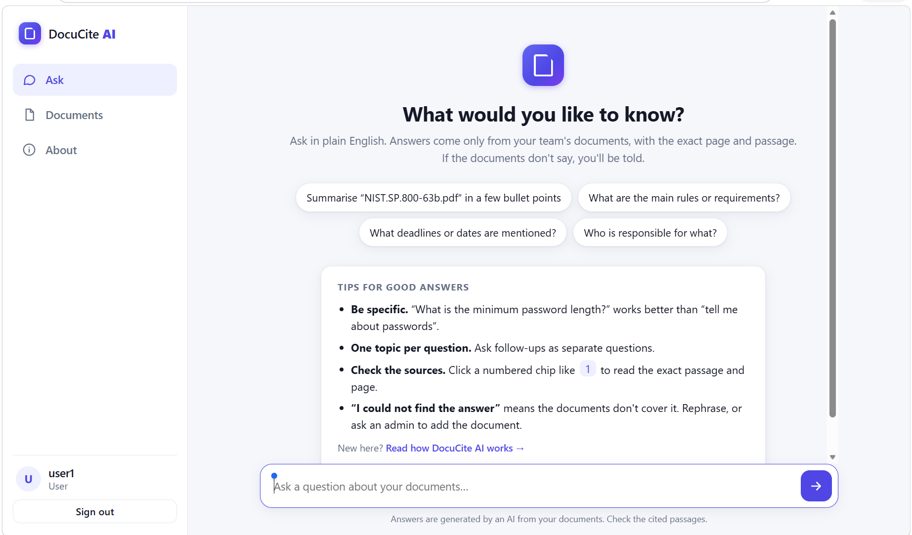
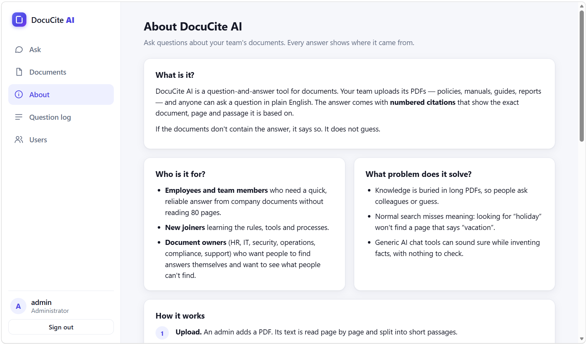
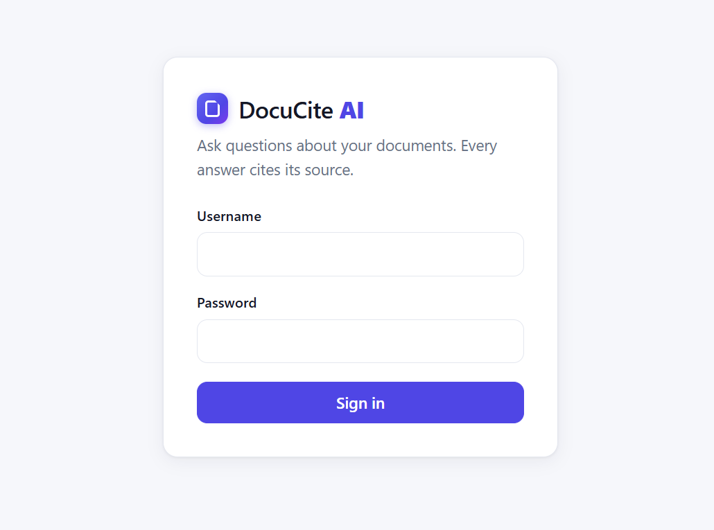
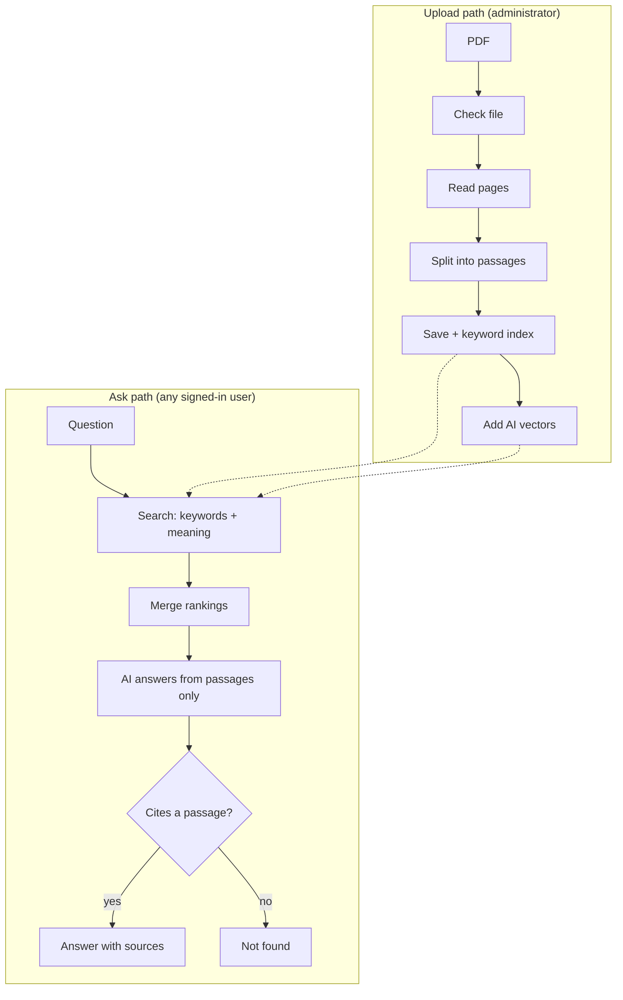

# DocuCite AI

[](https://github.com/yuvathkumar/docucite-ai/actions/workflows/ci.yml)


**Ask questions about your team's PDFs in plain English, and get answers that cite the exact document, page and passage.** If the documents don't contain the answer, it says so instead of guessing.



## Why it exists

- Knowledge is buried in long PDFs, so people interrupt colleagues or guess.
- Keyword search misses meaning: a search for "holiday" won't find a page that says "vacation".
- General AI chat tools can sound sure while inventing facts, with nothing to check.

DocuCite AI answers **only from your own documents**, and every claim points to a page you can open and verify.

## Features

- **Cited answers:** numbered citations; click one to read the exact passage, document and page. An answer that cites nothing is never shown.
- **Honest "not found":** when the documents don't say, you're told so.
- **Hybrid search:** SQLite FTS5 keyword ranking (BM25) plus vector similarity (cosine, pure Python), merged with Reciprocal Rank Fusion. If the embedding provider is down, keyword search still answers.
- **PDF ingestion:** page-aware chunking with overlap, duplicate detection (SHA-256), size and file-signature checks.
- **Roles and audit log:** admins upload and delete documents, manage users and review the question log; users ask questions.
- **Secure by design:** salted PBKDF2 password hashes, signed session cookies, parameterised SQL, model output treated as untrusted.
- **Web interface:** single-page app with no build step, light and dark themes, mobile friendly, with an in-app About page and tips.
- **Provider-agnostic:** Gemini sits behind `Embedder` and `ChatModel` interfaces; the 120 tests use fakes and never touch the network.

> **Privacy:** passage text and questions are sent to the AI provider (Google Gemini). On the free tier Google may use them to improve its products, so do not upload confidential documents.

## Screenshots

**Documents and indexing status**



**An honest "not found" instead of a guess**



**Question log for administrators**



**What a regular user sees**



**About page and sign-in**





## How it works



## Try it

The easiest way to see it work is with two public-domain US government documents (recorded in `data/SOURCES.md`):

| Document | Download | Questions to try |
|---|---|---|
| NIST SP 800-63B, Digital Identity Guidelines | [PDF](https://nvlpubs.nist.gov/nistpubs/SpecialPublications/NIST.SP.800-63b.pdf) | "What is the minimum length for a user-chosen password?", "Should passwords expire periodically?" |
| IRS Publication 1, Your Rights as a Taxpayer | [PDF](https://www.irs.gov/pub/irs-pdf/p1.pdf) | "What are my rights if I disagree with the IRS?", "Can I get help if I cannot pay my taxes?" |

Also ask something the documents don't cover, such as "What is the capital of France?", to see the "not found" behaviour.

## Tech stack

| Layer | Technology |
|---|---|
| Language | Python 3.12+ (developed on 3.15, CI on 3.13) |
| Web | FastAPI, Uvicorn, Pydantic, vanilla JavaScript front end |
| Database | SQLite through SQLAlchemy 2.0, with FTS5 for keyword search |
| PDF parsing | pypdf |
| AI | Google Gemini API (free tier), called over HTTP with httpx |
| Quality | pytest, ruff, mypy (strict), GitHub Actions |

## Run locally (Windows, PowerShell)

1. **Create and activate the virtual environment**
   ```powershell
   python -m venv docucite-ai
   .\docucite-ai\Scripts\Activate.ps1
   python -m pip install --upgrade pip
   python -m pip install -e ".[dev]"
   ```

2. **Configure the environment**
   ```powershell
   Copy-Item .env.example .env
   ```
   Open `.env` and set:
   - `GEMINI_API_KEY` (free key: https://aistudio.google.com/apikey)
   - `SECRET_KEY` (a long random string; signs the login cookie)
   - `ADMIN_USERNAME` / `ADMIN_PASSWORD` (the first admin, created on first start)

   Never commit `.env`.

   On Windows with Smart App Control, also set once (then reopen the terminal):
   ```powershell
   [Environment]::SetEnvironmentVariable("DISABLE_SQLALCHEMY_CEXT_RUNTIME", "1", "User")
   ```

3. **Check the AI connection** (optional)
   ```powershell
   python scripts/check_llm.py
   ```

4. **Run the app**
   ```powershell
   python -m uvicorn app:create_app --factory --reload
   ```
   Open http://127.0.0.1:8000 and sign in with the admin from `.env`. API docs are at `/docs`, health at `/health`.

5. **Run the tests and checks**
   ```powershell
   python -m pytest -v
   python -m ruff format --check .
   python -m ruff check .
   python -m mypy app
   ```
   `mypy` may be blocked by Smart App Control on Windows; it always runs in CI.

### Settings

All settings are environment variables or `.env` entries (see `.env.example`).

| Setting | Default | Meaning |
|---|---|---|
| `GEMINI_API_KEY` | empty | Gemini API key |
| `GEMINI_MODEL` | `gemini-3.5-flash` | Chat model |
| `EMBED_MODEL` | `gemini-embedding-001` | Embedding model |
| `MAX_UPLOAD_MB` | 20 | Largest accepted PDF |
| `CHUNK_MAX_CHARS` / `CHUNK_OVERLAP` | 1200 / 200 | Passage size and overlap |
| `ANSWER_TOP_K` | 5 | Passages given to the model per question |
| `SECRET_KEY` | empty | Signs login cookies (random per start if empty) |
| `ADMIN_USERNAME` / `ADMIN_PASSWORD` | `admin` / empty | First admin, created on first start |

## Project structure

```text
docucite-ai/
├── app/
│   ├── __init__.py        App factory (create_app)
│   ├── config.py          Settings from environment and .env
│   ├── db.py              Engine, sessions, FTS5 index helpers
│   ├── models.py          Users, documents, passages, vectors, question log
│   ├── llm/               Embedder and ChatModel interfaces, Gemini, test fakes
│   ├── rag/               Chunking, ingest, embeddings, search, prompts, answers
│   └── web/               Routes (auth, documents, ask, health) and the static web UI
├── tests/                 120 tests with fakes and in-memory databases
├── scripts/               check_env.py, check_llm.py
├── data/SOURCES.md        Source and licence of every sample document
├── docs/screenshots/      README images
└── .github/workflows/     CI: format, lint, types, tests
```

## Quality

Every change is checked by formatting (`ruff format`), linting (`ruff check`, including docstring rules), strict type checking (`mypy`) and 120 pytest tests. The same four checks run in GitHub Actions on every push. Tests cover failure paths too: rate limits, malformed AI responses, corrupt and encrypted PDFs, duplicate uploads, and unauthorised requests.

## Known limits

- Text-based PDFs only (no OCR for scanned pages).
- Only Gemini is implemented as the AI provider; on its free tier, chat is limited to roughly 20 requests per day per model, and the app says when the limit resets.
- No conversation memory: each question stands alone.
- Basic account management: no password reset and no login rate limiting yet.
- Built for one team on one machine, not as a production service.
